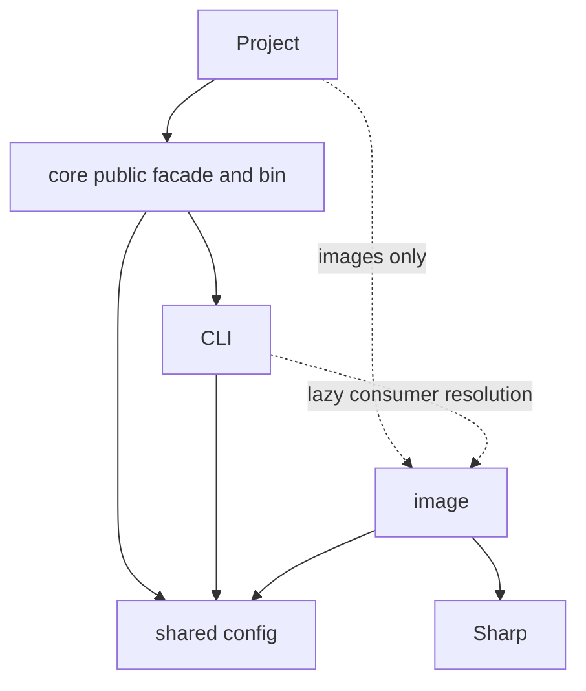

# JUD-83 shared configuration boundary proposal

Status: Superseded. Judah approved option A (shared config package) on October 21, 2026;
on October 23, 2026 at 12:16 PM CT that was replaced by the decision to fold the
config source into `@zenithbuild/core` (`@zenithbuild/core/config` and its
subpaths). PR #235 no longer contains a `@zenithbuild/config` package. The text
below is kept as the record of the original proposal.
Implementation is in draft PR #235. Validation and independent review remain
required; approval of this boundary does not approve a merge or release.

## Recommendation

Use a small, independent configuration package beneath core, CLI and image.
The approved name was `@zenithbuild/config` (superseded on October 23, 2026 at
12:16 PM CT: the config source now lives in `@zenithbuild/core/config`); the public
registry lookup returned 404, which does not establish publish permission. Keep core's public config exports and public `zenith`
bin as compatibility facades. Keep the image package absent from the CLI's
runtime dependency manifest; CLI uses it as a development fixture only.
Projects install it explicitly when images are needed.

This changes the handoff's suggested physical home in core. It avoids the
existing core -> CLI dependency becoming a cycle when CLI needs shared
configuration. The cost is one additional lockstep package. That packaging
cost was explicitly approved by Judah before implementation.

## Evidence and current contracts

At baseline f504c98:

- core/package.json depends on CLI, compiler, bundler, runtime and router.
- Only core owns the public `zenith` bin; its contract test enforces this.
- core/src/config.ts is 471 lines; CLI src/config.js is 319 lines. They each
  load and validate configuration. Plugin config helpers also exist twice.
- CLI config imports image normalization from images/shared.js, which also
  imports CLI base-path helpers. Moving that entire module into an optional
  image package would make ordinary config loading require the image package.
- Core's public root and config-subpath exports are locked contracts. CLI
  also tracks explicit/loaded configuration using private metadata and owns
  project pages/output path resolution. Those details cannot be discarded.
- Both loaders resolve TypeScript from the consumer (with a package fallback)
  for TS config files. Consolidation must preserve this existing requirement.

An initial differential probe covers 12 cases: defaults, unknown keys,
base-path normalization/errors, image quality bounds, format normalization,
width sorting, remote patterns, local-network policy types and cache TTL.
Core/CLI public values, acceptance/rejection and error text match in all 12.
`config-boundary-parity.spec.js` records these cases. This is a starting
matrix, not proof of parity for plugins, TS loading or private metadata.

## Options

| Option | Dependency result | Compatibility and cost |
| --- | --- | --- |
| A: independent config package (recommended) | core -> CLI; core, CLI and image -> config; image -> Sharp | Keeps current bin ownership and core public API. Adds one small package and its release/consumer gates. |
| B: make core a lower layer | CLI and image -> core; remove core -> CLI | Requires moving the public bin to CLI or redesigning installation of the launcher. Core's other aggregation dependencies also need review so installing image/config does not drag in native tools. This is a broader packaging migration. |
| C: defer consolidation and copy helpers | Existing duplication persists or increases | Smaller immediate edit, but conflicts with the supplied handoff and creates another source of config/security-policy drift. Not recommended. |

Do not introduce CLI -> core while leaving core -> CLI in place. Do not make
image depend on CLI for shared helpers. Do not reuse the agent-rule package,
router or browser runtime as an unrelated configuration container.

## Proposed ownership under option A

The configuration package owns the schema/defaults, validation, base-path
functions and shared plugin-config validation. Its Node-only config loader
is a separate module from the pure helpers. It has no Sharp, native-tool,
runtime/router, CLI or core runtime dependency. TypeScript remains resolved
only when a TS config is loaded, following the current consumer contract.

Core keeps its current public names and types by delegating to this source.
Do not add root exports or change defineConfig's typed contract implicitly.
CLI keeps its private explicit/loaded metadata and project path facades;
those wrap the canonical implementation rather than a second schema.
Image owns transformations, request handling, materialization, payloads and
Image.zen, importing pure config/base-path helpers from the lower package.
Adapters use the loader's image manifest and runtime/component paths.

The dashed CLI edge is runtime resolution, not a hard or optional dependency
that silently installs image/Sharp. Existing compiler/bundler boundaries and
Rust image materialization stay unchanged. Image.zen's existing fallback
constants/rendering must be checked against the shared schema; do not invent
a new component-import or DOM primitive to centralize them.

## Implementation sequence after approval

1. Extend differential coverage to JS/TS config imports, cache invalidation,
   plugin hooks/freezing, strict unknown-key errors and CLI private metadata.
   Any mismatch requires an explicit disposition before choosing behavior.
2. Introduce the approved config package and move one authoritative source
   into small modules. Add exact train pins and publish/pack ordering before
   core/CLI/image. All edited/created source files stay below 500 lines.
3. Convert core and CLI to facades. Preserve public exports, diagnostics,
   bin ownership and configuration semantics. Remove duplicated implementation
   only after both existing test suites and parity tests pass.
4. Complete JUD-83's image/component move and loader/adapters wiring. Detect
   image needs before compiler execution or output mutation. Missing image
   package fails with the exact-train install command. Recheck usage in dev.
5. Move/update image tests and the Sharp floor, update image templates and
   migration docs, and qualify generated/relocated Node and hosted artifacts.

## Verification and approval boundary

- Core API/bin contracts and all core/CLI config/plugin/type tests pass.
- No-image build/dev/preview works with no image or Sharp installed.
- Missing-package failures precede native probes, compilation and cleanup.
- Real image output, caching and remote-image security checks remain intact;
  validate relocated Node SSR and Vercel/Netlify packaging independently.
- Scratch npm 12, pnpm 10 and Bun installs prove the final dependency graph.
  Record versions, machine, three runs per manager, cold/warm method, bytes
  and installed packages. Friday's verifier independently checks the results.
- Frozen install, exact release train, packed consumers and full CI pass.
  Existing JUD-21 security findings still require their own disposition.

Requested decision: approve option A and the extra package boundary/name, or
choose option B's broader core/bin migration. Authorizing this proposal did
not authorize either architecture implementation, publishing or a merge.
